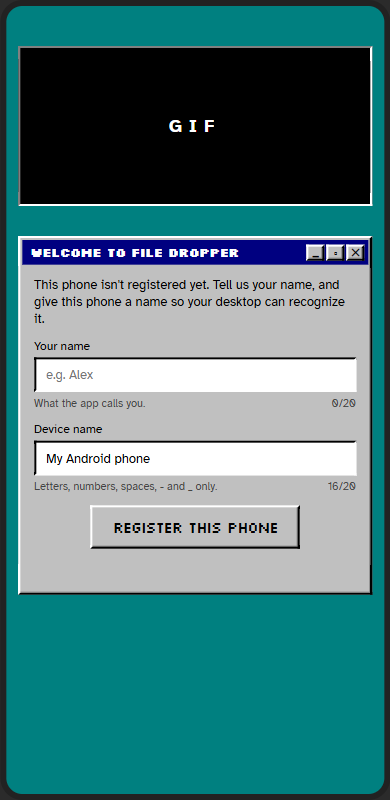
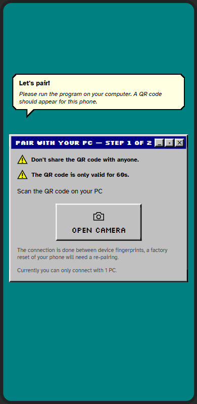
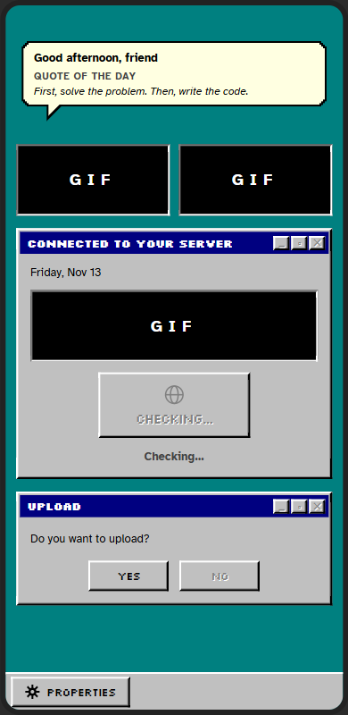
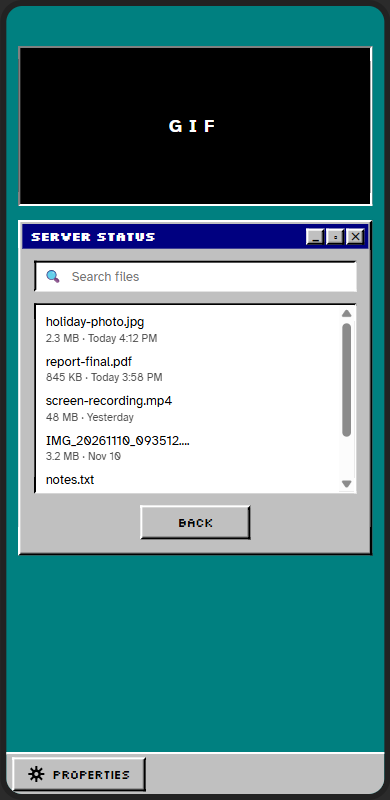
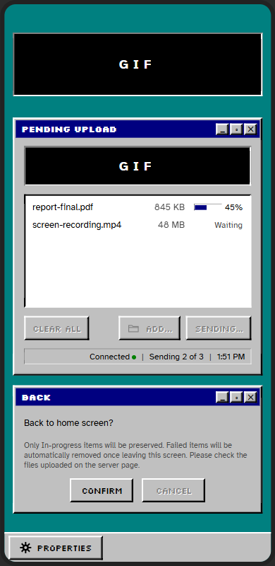
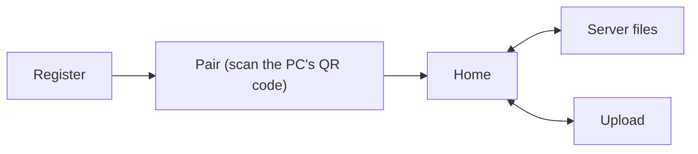

# Project Dropper Mobile

The Android app for Project Dropper.

## How it works

<table>
  <tr>
    <td align="center"><br><sub>1. Register</sub></td>
    <td align="center"><br><sub>2. Pair</sub></td>
    <td align="center"><br><sub>3. Home</sub></td>
    <td align="center"><br><sub>4. Server files</sub></td>
    <td align="center"><br><sub>5. Upload</sub></td>
  </tr>
</table>



1. **Register**: on first launch, enter your name and a name for the phone. The phone
   registers itself with your own server; there's no password to remember.
2. **Pair**: open the camera and scan the QR code that the desktop app shows. The desktop
   app lives in its own repo, [project-dropper](https://github.com/pinghsuanC/project-dropper).
   A phone pairs with one PC.
3. **Home**: greets you with a quote of the day, checks the connection to your server, and
   asks whether you want to upload.
4. **Server files**: see and search the files already on the server.
5. **Upload**: add files to the queue and send them to your PC, with progress for each file.

From then on, the app signs in by itself each time it starts and opens Home. These are the
main screens only; every screen and error state is in
[`context/prototypes/`](context/prototypes/) (see [Prototype](#prototype)).

## Tech

- **[Expo](https://expo.dev)** (SDK 58): React Native framework, with Expo Router for navigation
- **[TypeScript](https://www.typescriptlang.org)**
- **[Claude](https://claude.com/claude-code)**: built with Claude Code

## Run

```bash
npm install
npx expo start
```

## Prototype

The clickable HTML prototype is `context/prototypes/temp/index.html`. Serve it with
`python -m http.server 5500 --directory context/prototypes/temp` (or the `prototype`
entry in `.claude/launch.json`) and open `http://localhost:5500`. The yellow DEV button
opens a menu of every screen.

Screenshots live next to it, one folder per DEV-menu category (`landing/`, `register/`,
`home/`, …), each file prefixed with its category. Timed flows are saved as numbered
frames (`register-submit-01.png`, `-02`, …).

# Project Overview

File Dropper sends files from your phone to your own PC, through a server you run
yourself. There are three pieces:

- **This app** (Android, Expo): registers the phone, pairs it with a PC, and uploads files.
- **The server** (FastAPI): signs devices in, pairs them, and hands out upload links.
  File bytes go straight to cloud storage (Cloudflare R2), not through the server.
- **The desktop app**: shows the pairing QR code and downloads the files sent to it.

The server and desktop app live in
[project-dropper](https://github.com/pinghsuanC/project-dropper).

**Built so far:** a route for every screen, the Windows 98 look and its shared components,
sign-in on every start-up (register once, then sign a server challenge with the phone's
own key), and a dev-only testing menu that opens any screen in any state.

**Next:** pairing with the PC, the server file list, and sending files. Their server
routes are still planned, so they wait on the server.

**Further reading:**
- [`CLAUDE.md`](CLAUDE.md) "How the app works": the sign-in, pairing and upload steps.
- The server's `API.md`: every route, with its status (built or planned).
- [`context/details/`](context/details/README.md): design and architecture decisions.

## Future features

Listed under `# Future Features` in `context/tracker/current-feature.md`.

## Open decisions

Listed in [`context/tracker/open-decisions.md`](context/tracker/open-decisions.md).
